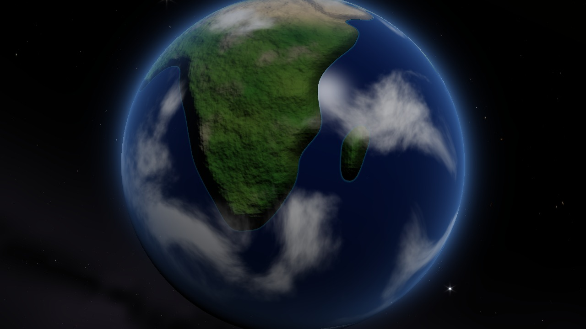
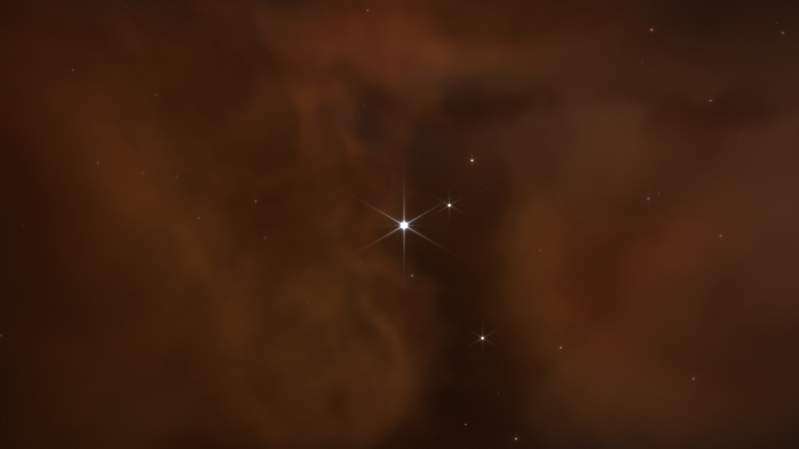
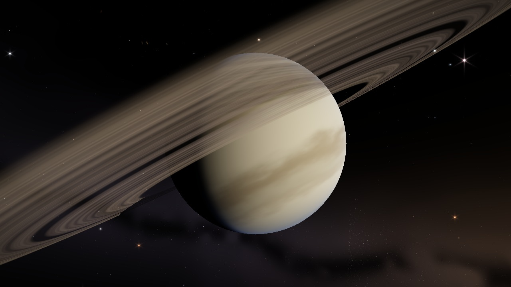
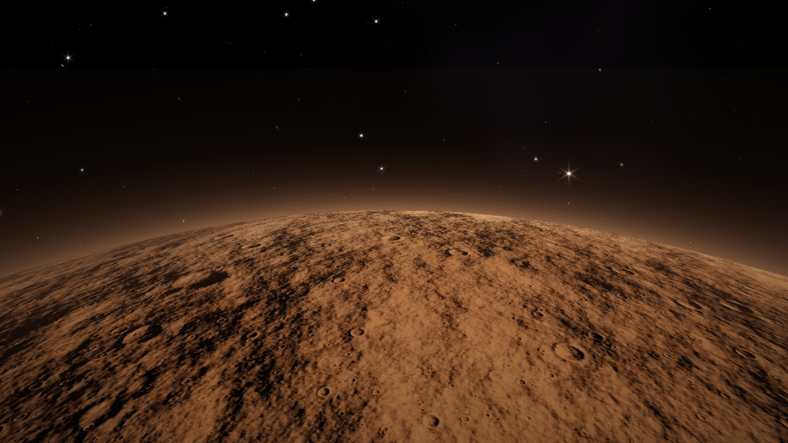
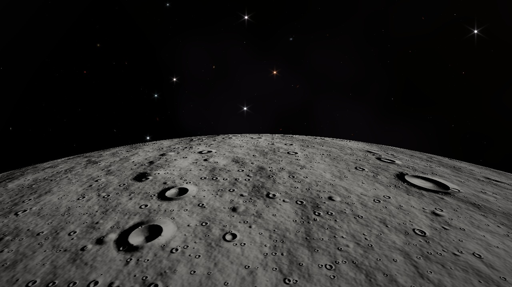

# Pocket Universe

**A universe you can fly through in your browser, in one small HTML file.**

Start inside a glowing nebula, cross the Milky Way, and arrive in the Solar System: the Sun, Earth and Moon, Mars, Jupiter, Saturn and more. Fly right down to the surface of any of them.

There are no images, no 3D models, no sound files and no libraries. Everything you see and hear is generated by code when the page loads.

**▶ Live demo:** `https://sharminmz.github.io/pocket-universe/`
**▶ Video:** `https://youtu.be/zu0ws2Lqkm0`

## Try it

Open the live demo, or download [`index.html`](index.html) and double-click it. Nothing to install, and it works offline.

It needs a browser with WebGL2: any recent Chrome, Edge, Firefox or Safari. A laptop or desktop works best.

## Controls

| Input | Action |
| --- | --- |
| `W` `A` `S` `D` | Move |
| Drag with the mouse (or one finger) | Look around |
| On-screen stick and ▲ ▼ (phones and tablets) | Move, up / down |
| `Space` / `C` | Up / down |
| `Shift` | Fly faster |
| `T` | Autopilot on / off (a guided tour of everything) |
| `L` | Show / hide the names of places |
| `M` | Sound on / off |
| `F` | Fullscreen |

The **Destinations** button flies you straight to any object. Movement slows down automatically as you get close to a surface, so you can explore it up close.

## What's out there

| | |
| --- | --- |
|  |  |
|  |  |

- **A volumetric nebula** you can fly inside, lit by three young stars
- **Stars with six-pointed diffraction spikes**, in the style of James Webb Space Telescope images, and hundreds of faint background galaxies
- **The Milky Way** as a band of dense stars and dark dust lanes across the sky
- **A spiral galaxy** made of 72,000 slowly rotating particles
- **The Sun**, with a granulated surface and corona
- **Earth**, with continents, oceans, clouds, polar ice, a blue atmosphere and city lights on the night side
- **The Moon, Mercury and Ceres**, covered in impact craters
- **Mars**, with rust-coloured plains, craters and polar caps
- **Venus, Jupiter** (with its Great Red Spot), **Saturn** (rings that cast and receive shadows), **Uranus and Neptune**
- **Io and Europa**, two of Jupiter's moons
- **An asteroid belt** and **a comet** with two tails
- **Ambient sound**, synthesised live with the Web Audio API

## How it works

Everything lives in [`index.html`](index.html): markup, styles, shaders and logic. It uses WebGL2 directly.

- **Nebula:** ray-marched 3D noise, rendered at reduced resolution and scaled up. The resolution adapts to the speed of the machine.
- **Planets and moons:** each pixel casts a ray against a sphere, then a shader computes the surface from layered noise. The number of noise layers grows as you approach, so there is always finer detail to find.
- **Craters:** a cell-based crater function repeated at several scales.
- **Earth:** rough continent outlines (about 300 hand-placed coordinates) are drawn to a small texture at load time, then roughened with noise in the shader.
- **Stars, galaxy, asteroids, comet:** GPU points, drawn additively.
- **Sound:** oscillators, filtered noise and an echo network.

## Honest notes

- **Not to scale.** Distances and sizes are compressed. At true scale the planets would be invisible dots.
- **Earth's continents are approximate.** They are recognisable, not a precise map.
- **Other surfaces are invented.** Mars looks like Mars, but its craters and plains do not match the real ones.
- **This is a visual experience, not a scientific simulation.** Nothing orbits.

## Put it online with GitHub Pages

1. Create a public repository and upload these files.
2. Go to **Settings → Pages**.
3. Under **Build and deployment**, choose **Deploy from a branch**, then `main` and `/ (root)`.
4. After a minute the page is live at `https://YOUR-USERNAME.github.io/REPOSITORY-NAME/`.

## Making the trailer

[`tools/record.py`](tools/record.py) renders a scripted fly-through frame by frame in headless Chrome (using Playwright), and [`tools/music.py`](tools/music.py) synthesises the score, timed to the cuts. See the comments at the top of each script.

## Credits

Made by Sharmin Mojtahedzadeh, written with Claude (Fable 5.2) by Anthropic.

Inspired by [Abyssal Garden](https://github.com/Noniv/abyssal-garden) by Maksymilian Dendura, an underwater world in a single HTML file.

## License

[MIT](LICENSE)
